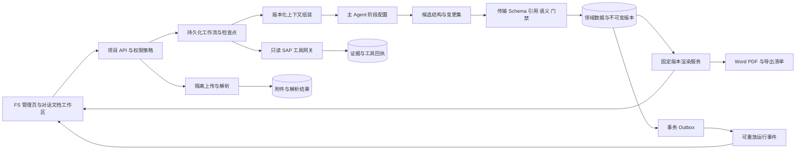
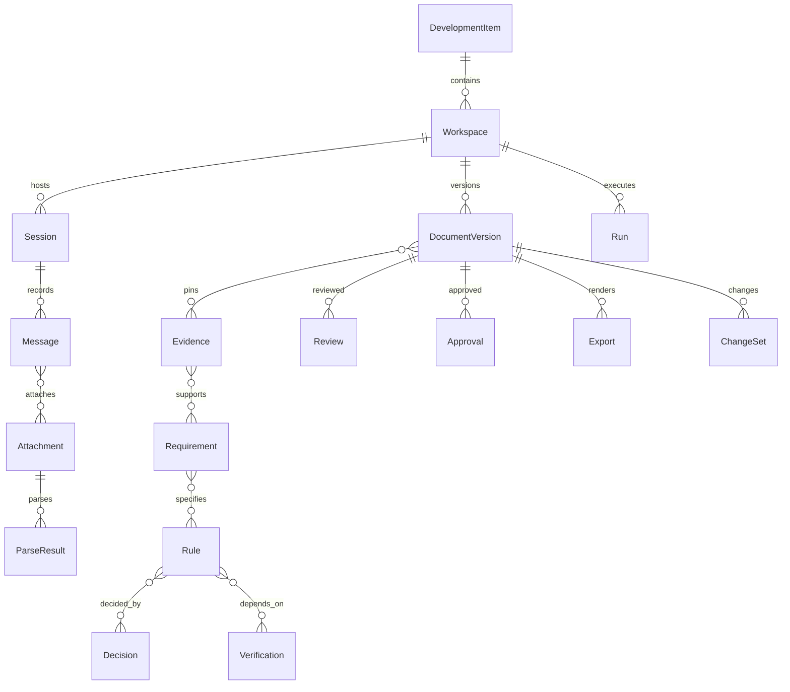
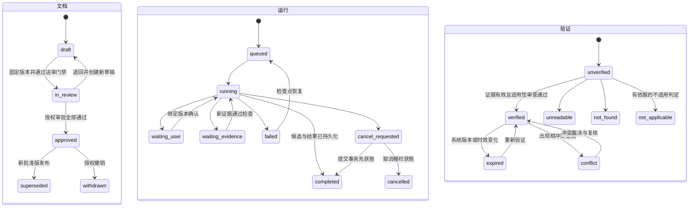
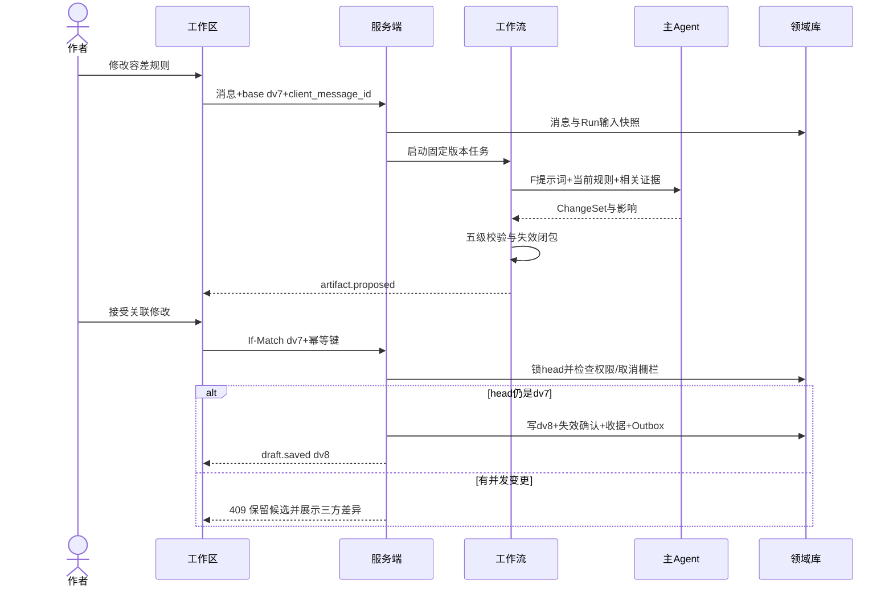
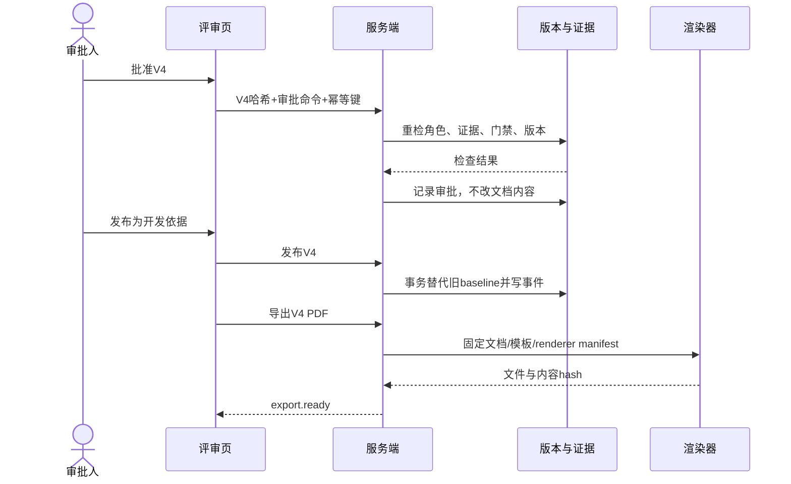

# FS 智能工作区专业设计方案

面向产品、设计、SAP 顾问与研发的设计评审稿。设计日期：2026-10-03（Asia/Shanghai）。范围：S/4HANA On-Premise / Private Cloud Edition，传统 ABAP。推荐采用主 Agent、显式工作流、结构化需求与文档、服务端交付门禁，先验证从材料到已批准开发依据的闭环。

本交付是设计资产，不是已实现功能；未修改产品代码、未连接 SAP 验证清账对象、未运行平台。静态代码阅读能够证明下面列出的代码行为，不能证明生产配置、运行安全性或用户实际体验。标记约定：**资料事实**来自本地文件或已访问网页；**设计建议**是本方案选择；**待验证假设**必须在实施或试点时核实。

配套交付：[完整提示词包](prompts/agent-prompts.md)、[契约与校验说明](contracts.md)、[Schema 目录](schemas)、[样例目录](examples)、[验收用例](acceptance.md)、[校验程序](validate_contracts.py)。所有 JSON 文件是完整可解析文件，正文不以省略号代替契约内容。

## 1. 专业判断与参考资产评估

### 1.1 判断与假设

FS 的核心产品单位应是“可追溯的设计决定”，其表达载体是版本化文档。聊天用于提出意图和操作，不能兼任唯一事实库。结构化数据须能回答：这条规则来自哪里、谁确认了哪个版本、依赖什么 SAP 证据、修改后影响哪些测试、现在哪个版本可以用于开发。

**待验证假设**：项目已有登录与项目隔离基础，可增加对象存储与持久化任务执行器；业务顾问为主要作者，ABAP 顾问负责可行性与技术评审，业务负责人批准业务口径。审批角色是否允许兼任由项目策略配置；高风险财务开发默认作者不得独自批准。没有假设现平台已具备 OCR、AI 工作流或正式审批引擎。

FS 可包含实现可行性所必需的技术结论，但不承担完整 TS 与代码实现。清账等有财务副作用的需求可以在此设计和验证依据，FS 工作区的 SAP 工具仍然只读，不执行清账、过账或改变业务配置。

### 1.2 已读取资产及发现

已读取指定目录 `D:/AI/Agents/abap-fsd-agent` 的 AGENTS.md、两份模板、MCP 使用和证据规则、评审清单、权限规则、回归用例，以及 MM 示例的输入和完整三阶段输出。SD 和 FI 示例输入及三阶段文件均为 0 字节，因此不能把它们算作覆盖案例。MM 示例的“已通过 MCP”是历史文档中的声明；本次未取得其原始调用回执，不能升级为当前系统证据。

具体缺陷与矛盾：

- 三阶段人工锁适合单用户文档助手，若逐字继承会阻止后台解析、自动检查和讨论稿预览。
- stage_output_template 的阶段二结论允许存在未确认对象，但同文件准入门禁要求关键依赖闭合；产品必须按问题影响分级，不靠“阶段完成”文字放行。
- 权限设计规则从 TSTCA/SU24 提案推导对象是合理线索，但不是运行时授权验证，也不能证明当前用户有权。
- MCP 使用规则把“当前 MCP 优先”写成冲突裁决；在系统、Client、时间或查询范围不一致时，应先判断可比性，不能覆盖另一来源。
- MM 示例 Stage 3 的 HSL_AMT 引用 TV-03，但本位币验证实际是 TV-04；Stage 2 结论只提 TV-01 至 TV-09，而表中有 TV-10。稳定 ID、引用完整性和全量覆盖检查应捕获此类遗漏。
- MM 示例把三个月解释为默认 90 天、把 FIFO 作为账龄展示设计。这些在项目中应是有适用条件的建议，不能当作客户财务口径已确认。
- 示例缺少实际对账样本，却有部分金额、历史状态待验证；其中会改变核心算法的项必须升级为发布阻断，不能仅因被命名为技术验收项就延期。

### 1.3 继承、调整、不采用

| 参考思想或规则 | 处理 | 理由与产品化方式 |
|---|---|---|
| OP/PCE、传统 ABAP、非代码输出 | 继承 | 模板与目标系统配置显式声明，越界需求产生范围冲突 |
| Fit-to-Standard、对象关系、生命周期、真实颗粒度 | 继承 | 转为稳定规则 ID 和开发类型检查集 |
| SAP 对象零信任、结论关联证据 | 继承 | 服务端证据台账验证来源、系统、范围、时效和适用性 |
| 生成阶段不得新增核心决策 | 继承 | FsProposal 与确认集做语义差异检查；新增决策返回分析节点 |
| 输入输出一览、处理路径、权限、测试五章 | 继承 | 默认交付模板；界面可保留九个阅读导航锚点 |
| 阶段一、二、三每次整体人工确认 | 调整 | 关键业务决定逐项绑定版本确认；分析与只读检查自动执行 |
| 技术未验证必须先问用户才能继续任何文档 | 调整 | 可自动生成显著标记的讨论稿；正式发布门禁不因用户放行绕过 |
| 所有阶段内容全文重写 | 不采用 | ChangeSet 原子变更集、关联影响和不可变版本 |
| 同目录覆盖，不许 v2/backup | 不采用 | 保留不可变修订与审计；旧批准版不被草稿覆盖 |
| 固定最多 3/5 个问题、每次必须单问 | 调整 | 默认每轮 1—3 个关键问题，显示总数与完整问题抽屉 |
| 查询 4 批次、15 子查询，快照内部查询不计入 | 不采用 | 总预算涵盖所有远程调用；按风险、价值和实测调整 |
| 4—6 分钟、复杂不超 8 分钟 | 不采用 | 未测量不作承诺；记录处理、SAP 等待和人工等待分别统计 |
| 精确源码准入与有限深度 | 调整 | 默认零源码；授权范围内按明确问题升级，工具网关限深度、字节、时间 |
| 常规业务口径自动确定 | 调整 | 显示适用条件；关键财务规则与客户特例必须确认 |
| SU24/TSTCA 权限提案 | 调整 | 仅作候选依据；另查运行时设计、组织裁剪与实际角色测试 |
| 最终正文不展示全部 MCP 过程 | 继承 | 保留必要结论与证据脚注；审计包独立保存 |
| MCP 与材料冲突时一律信 MCP | 不采用 | 同系统、Client、版本、时点、范围可比后再裁决，冲突记录不可删除 |

### 1.4 实际平台静态核对

证据位置：`apps/web/src/features/delivery/model.ts` 的 chapters、`FsEditor.vue`、`apps/api/src/delivery/fs.mjs` 和 `validation.mjs`。

**资料事实**：当前九章以 `Record<string,string>` 保存；草稿接口使用 rowVersion 和行锁检查冲突；版本快照独立保存；提交接口检查编号、rules/acceptance/cases 非空、人员配置及阻塞原因后创建快照，设置 submitted_version_id，并把开发项 stage 设为 ready。维护权限在读取的路由中限制为业务负责人或项目内管理员。前端支持单章编辑、历史对比和本地 txt 草稿下载。

**设计建议**：复用现有不可变版本与乐观锁思想；扩展为审批与发布分离。旧 submitted_version_id 导入为“历史开发依据，审批来源为 legacy_submission”，不能伪造新审批记录。迁移前保留原文、哈希和旧章节键。

平台开发类型包含 function/interface/report/enhancement/form，与参考报表/接口/增强/批处理/工具不完全一致。新增 `fs_profile`，不改变原开发项类型：report→报表、interface→接口、enhancement→增强；function 由用途映射工具或批处理；form 单独保留打印表单 profile（模板兼容性待决定），不可默认为报表。本次未发现能证明平台已明确采用 Public Cloud 或 Fiori 的证据；不扩大 SAP 架构范围。

## 2. 推荐架构及方案比较

| 方案 | 质量与一致性 | 成本、延迟 | 可解释与恢复 | 研发复杂度 | 判断 |
|---|---|---|---|---|---|
| 直接聊天生成整篇 | 易遗漏、静默改规则；引用难验证 | 原型便宜，长文反复生成成本高 | 历史重放粗糙，难恢复部分成果 | 低起步，高治理补课 | 仅用于不承诺交付的概念验证 |
| 主 Agent + 显式状态机 + 结构化文档 | 可做版本门禁、确定性校验、关联更新 | 前期建设成本中等，增量修改可降重复 token | 每步有输入输出和检查点；可审计 | 中等 | 推荐 MVP 与主体架构 |
| 多 Agent 自治协作 | 可并行专业视角，但共识不等于事实 | 多轮协调增加费用，尾延迟难预测 | 分歧、权限与恢复更复杂 | 高 | 暂不采用；离线评估证实收益后再引入 |

这是设计比较，不是实测性能排名。质量评审可以是同一主 Agent 的独立调用；规则引擎和人工审核才构成独立的质量来源。多个模型互相同意不提供独立 SAP 事实。



建议基于现有项目 API 和数据库先做模块化服务：文档领域、工作流、证据、解析、渲染分别有接口边界，不先拆微服务。持久化任务可用数据库作业表与租约，也可评估 Temporal 等；框架不是正确性的前提。必须具备任务抢占 fencing token、超时、幂等提交、事件重放和检查点。Agent SDK 的会话与 max_turns 只解决部分调用编排，不等同于业务事务和持久恢复。

工具分三类：模型只读工具 `context.read / evidence.lookup / sap.discover / sap.metadata / sap.signature / sap.authorization_proposals`；模型候选输出不直接写库；服务端命令 `draft.apply / decision.confirm / review.submit / approval.record / baseline.publish / export.create` 由用户动作或政策允许的工作流调用。工具网关从已认证请求注入项目、目标连接和权限，模型提供的这些值只做一致性校验。

## 3. FS 与 TS 边界及领域模型

### 3.1 职责边界

| 产物 | 必须承担 | 不承担 |
|---|---|---|
| FS | 目标、范围、业务对象与颗粒度、输入输出、分支/处理顺序、日期金额口径、权限行为、异常、验收；必要技术依据 | 完整类设计、SQL 实现、编码风格、部署脚本 |
| 技术可行性分析 | 目标系统可用性、关键字段/接口/增强、关联语义、事务和锁可实现性、重大容量约束，记录限制 | 代替业务确认、证明未测试容量 |
| TS | 模块划分、具体数据访问、接口调用方式、事务实现、锁顺序、缓存/分包、日志与测试实现 | 擅改已批准业务规则；发现不可行应提变更 |
| ABAP 代码 | 实现批准 FS/TS 并通过测试、传输与上线控制 | 反向替业务负责人确认规则 |

FS 必须包含会改变业务结果的处理键、匹配优先级、最小颗粒度、幂等与事务边界语义；TS 决定如何编码实现这些约束。关键接口是否支持模拟、部分成功、锁和提交，不能推到 TS 才首次发现。索引、内表类型等仅在关系到可行性时作为 FS 限制，其他留 TS。

| profile | 第 2 章形式 | 第 3 章额外关注 | 验收重点 |
|---|---|---|---|
| 报表 | 选择条件、输出字段、下钻 | 历史基准日、结果颗粒度、汇总单位、只读 | 分支对账与主表/明细/导出一致 |
| 接口 | 消息版本、字段映射、响应 | 外部业务键、重复/乱序、部分失败、重放、对账 | 同消息重发、契约变更和异常返回 |
| 增强 | 触发业务事件、上下文 | 触发时机、同一 LUW 限制、错误对主流程影响 | 不破坏标准事务与回滚 |
| 批处理 | 参数、调度窗口、结果 | 包/业务组事务、锁、断点、重入和审计 | 中断恢复、重复执行无重复结果 |
| 工具 | 操作输入、预览与执行结果 | 高风险操作确认、权限与撤销边界 | 模拟与执行差异、失败可解释 |

### 3.2 五章与现平台九章映射

| 五章 template_slot | 现平台键 | 迁移与显示规则 |
|---|---|---|
| overview 开发概述与范围 | background、scope | 保留原段落和来源；补对象关系/标准对标仅作建议 |
| io 输入选择与输出 | inputs、outputs | 一个章节、两个锚点；字段结构化，辅助自由段落 |
| logic 核心处理逻辑 | rules、exceptions | 将每条异常关联实际处理路径；无法映射的异常保留“待归属”，不丢弃 |
| authorization 权限设计 | authorization | 行为范围与技术对象证据分开 |
| validation 测试验收与技术验证 | acceptance、cases | 拆验收条件和稳定测试 ID；补覆盖关系 |

模板版本是不可变资源：`template_id, semver, compatible_schema_versions, profile, slots[{stable_slot, title, order, allowed_block_kinds, required_when}], validation_ruleset, renderer_version, migration_id`。前端读取模板，不写死章节数组；提示词注入模板版本。大版本改变结构需显式迁移和差异审阅，小版本也不能静默重排已批准文档。章节 ID 不因标题或顺序变更而变化。预览中的事实脚注可折叠，导出有固定证据附录策略。

### 3.3 实体与基数

所有持久实体由服务端分配 ID、租户与项目归属、创建人及审计时间。实体 ID 稳定，revision 不可变；删除采用受控墓碑并检查引用。

| 实体 | 关键字段与关系 |
|---|---|
| 开发项 DevelopmentItem | 业务对象、责任人、类型；1:N FS 工作区；同一交付分支最多一个有效基线指针 |
| FS 工作区 Workspace | item_id、branch、draft_head、review_head、baseline_head；MVP 每开发项一个活动工作区，历史可归档 |
| 会话 Session | workspace_id；1:N 会话并存，共用文档事实库；不复制基线 |
| 消息 Message | session_id、序号、作者、内容、附件引用、目标选区；修改形成修订，不覆盖原意图 |
| 附件 Attachment | 内容哈希、存储版本、媒体类型、安全检查、项目 ACL；消息与附件 M:N |
| 解析结果 ParseResult | attachment_revision、parser_version、页/表/坐标、置信/覆盖、失败范围；附件 1:N 解析版本 |
| 来源证据 Evidence | 原消息/解析块/工具回执、locator、结论、系统/范围/时间/限制；N:M 需求和验证项 |
| 需求 Requirement | 稳定 ID/revision、来源、业务价值、验收引用、确认记录 |
| 业务规则 Rule | 前置条件、处理与结果的内容块、适用范围、依赖、确认；需求与规则 M:N |
| 决策 Decision | 选项、已选内容版本、理由、确认对象哈希、替代关系；可影响多个规则 |
| 问题 Issue | 问题、影响、责任角色、review/release/none 阻断等级、状态、解决依据 |
| SAP 验证项 Verification | claim、目标系统/Client/release、对象/范围、状态、证据、时间、适用性 |
| 模板版本 TemplateVersion | 不可变结构与渲染、校验规则版本；1:N 文档修订 |
| 文档版本 DocumentVersion | sections/blocks/tests、内容哈希、父版本、模板、证据清单、决策快照；不可变 |
| 变更集 ChangeSet | base version、操作、原值哈希、原因、依赖组、影响/失效；被接受后生成新修订 |
| 运行任务 Run | context snapshot、固定配置版本、状态、节点、租约、检查点、预算、候选结果 |
| 评审结果 Review | doc hash、规则集、覆盖、发现、评审来源；AI、规则引擎、人工明确区分 |
| 审批记录 Approval | 文档版本和哈希、审批人角色、政策、证据 manifest、动作、时间；不可由模型创建 |
| 导出产物 Export | document version/hash、template/renderer/font versions、内容 manifest、文件 hash、格式、权限和状态 |

基线与草稿同时存在：draft_head 指向最新接受修订；review_head 指向已冻结送审版本；baseline_head 指向最近批准并发布的版本。修订批准版会分出草稿，旧基线仍有效，直到新版本发布或有权限者明确撤销。发现旧基线重大缺陷时触发“建议暂停使用”，由授权角色执行 withdraw；系统可按既定强制安全政策阻止后续下载，不静默改写历史审批。

追溯链：消息/附件页 → Evidence → Requirement/Rule → Decision/Verification → Section/Block → Test → Review → Approval → Export。每条关联固定 revision 或 manifest 中的版本；“引用 ID 存在”与“该证据支持这句话”是两项独立校验。



## 4. 界面信息架构、线框图与交互状态

### 4.1 FS 管理页

管理页以业务状态和可用成果为主，不展示内部 Agent 阶段。主按钮按未建文档→开始编写、有草稿→继续编写、待评审且有评审权→查看评审、仅批准基线→修订已批准版本；只读用户始终“查看 FS”。已批准但有修订草稿时优先“继续修订”，同时显示旧基线。

```text
开发项 FI-042 / FS 管理                         [进入 AI 工作区]
FS 编号 FS-FI-042   供应商未清项批量处理  责任人：王顾问
业务状态：修订中               当前有效开发依据：V3 已批准 [查看]
当前草稿：修订 r18（基于 V3）  当前送审版：无              [版本与对比]
待决策 2 项 | 技术证据缺口 3 项 | 发布阻断 2 项            [查看问题]
附件：业务说明.pdf 已解析；截图.png 部分解析 2/3 区域       [管理附件]
最近修改：容差规则变更，影响 3 章、6 条测试，尚未确认
[继续修订] [查看有效开发依据] [导出…]
```

版本选择器清楚区分“工作草稿 r18”“送审 V4”“有效基线 V3”。附件列表显示上传人、来源版本、解析时间/覆盖和失效状态，不把文件已上传等同于解析成功。导出先选具体版本与讨论稿/正式产物；正式导出只能来自当前策略允许的已批准版本。旧版本导出要标明已替代，不能复用当前有效印章。

### 4.2 AI 工作区

```text
← FS 管理  FS-FI-042   草稿 r18 / 基线 V3   已保存 14:30   [版本] [提交评审]
[上下文与证据]  已带入开发项、目标系统、2 个材料版本  [查看快照/更新]
┌──────────────────────────┬────────────────────────────────────────┐
│ 对话                     │ 文档预览：草稿 r18                     │
│ 你：允许 1 元差额。      │ 1 概述  2 输入输出  3 逻辑  4 权限 5 验收│
│ AI：需要确定币种和差额   │ [讨论稿 · 2 个发布阻断项]               │
│ 处置；将影响匹配、结果、 │ 第 3 章 规则 R-04                       │
│ 权限与 6 条测试。        │ 非零差额保持未处理。[建议改动 1/4]       │
│ [按 CNY][按各币种][说明] │ - 旧规则 …                             │
│ 问题 1/2  [全部问题]     │ + 候选规则 … [来源 2] [影响 6]          │
│                          │ [接受完整关联修改] [拒绝]               │
│ [附件] 输入消息… [发送]  │ 选中文本 → [解释] [补充] [修改]          │
│ 任务：等待业务确认       │ [保存版本] [对比] [导出讨论稿]           │
└──────────────────────────┴────────────────────────────────────────┘
```

对话约 40%、成果约 60%，可拖动；窄屏通过“对话/文档”切换，保持版本固定条和阻断提示。章节导航、引用和问题定位均支持键盘；状态不只用颜色，异步状态用可访问播报，焦点不因流式内容跳走。

上下文抽屉分“原始材料、确认需求、决策、SAP 证据、未决问题、运行记录”，不混放成一串附件。每个引用显示原文定位、支持的结论、目标系统/时效和限制；无权限引用只显示“来源不可访问”，不泄露标题/摘要。文档最新版本固定在右侧，不以聊天附件作为唯一入口。

上传：先显示隔离检查，再解析页数/覆盖；部分成功保留可用段落并显示未识别页/区域。表格疑似错列用并排原图与解析表预览，由用户纠正数据，不要求用户解释技术元数据。上传到解析完成之间，AI 明确“尚未使用此文件”；不能用文件名猜内容。

澄清卡包含待确认规则原文、版本、影响、推荐理由、其他选项及自由补充；建议每轮 1—3 项，问题抽屉显示完整清单与责任方。业务决策点用“确认此规则”，技术缺口用“查看验证进度/联系技术负责人”；批准按钮仅向有审批能力的角色显示，服务端仍必须复核。

选区操作提交 `document_version_id + block_id + selection offsets + selected_text_hash`；解释只产生对话答案，不改文档；补充/修改产生 ChangeSet。接受操作展示关联变更组，不能只接受容差文字却遗漏测试更新。无依赖的变更组可分别接受；有依赖组原子接受。撤销已接受修改生成反向变更集，恢复历史版生成新草稿，不移动过去版本或删除审计。

直接编辑是辅助入口：编辑结构化块，在同一 version 前置条件下产生人工 ChangeSet；保存后重新计算内容哈希、上下文和依赖失效。AI 正在生成旧版本候选时，人工编辑不得被其覆盖。局部未保存内容保留受控恢复副本；共享终端默认不持久缓存敏感正文。

### 4.3 状态、界面与允许操作

这张矩阵展示状态组合；运行完成不意味着文档已批准，技术 verified 不意味着业务已确认。

| 文档业务状态 / 运行 / 验证 | 界面提示 | 可做 | 禁止或门禁 |
|---|---|---|---|
| 无草稿 / 空闲 / 未验证 | 开始编写 | 上传、发消息、选模板 | 正式导出、批准 |
| draft / running / 任意 | 正在分析材料；可继续补充 | 发送新消息、看稳定预览、取消 | 半成品自动替换当前草稿 |
| draft / waiting_user / 未确认 | 需要确认 2 项业务规则 | 版本绑定确认、继续讨论稿 | 把普通聊天“好”当无对象审批 |
| draft / waiting_evidence / unverified | 讨论稿，不能发布 | 只读验证、补资料、编辑其他部分 | 用户强行确认技术 verified |
| draft / failed / 任意 | 本次生成失败，r18 已保留 | 从检查点重试、改范围、看错误 | 自动重放未知写操作 |
| draft / cancelled / 任意 | 已取消，已保存内容仍在 | 新运行、采纳完整旧候选需重校验 | 接受取消后迟到的写回 |
| in_review / 空闲 / verified | V4 审阅中，内容冻结 | 评论、审批/退回、创建下一草稿 | 改写送审 V4 内容 |
| approved / completed / 有效 | V3 是有效开发依据 | 正式导出、修订、授权撤销 | 编辑 V3、继承审批到 V4 |
| approved / 空闲 / expired | 基线证据需复核 | 查看历史、发起复核、按策略限导出 | 把过期证据显示为当前有效 |
| superseded 或 withdrawn | 已替代/已撤销 | 授权历史查看、带状态水印导出 | 当作当前有效开发依据 |

### 4.4 进入、恢复与并发

- 首次进入：读取开发项及权限，展示上下文来源摘要，创建一次工作区与会话（幂等）；有旧 FS 时导入只读原文快照，不自动认定其中规则已确认。
- 再次进入：先读三个 head 和活动 Run，再读增量消息；显示上次停在何处及新材料。上下文更新是新快照，不偷偷改变在跑任务的输入。
- 刷新/关闭浏览器：任务继续由服务端执行；重新连接取 Run 快照与 last_event_sequence 后事件。关闭标签不等于取消。
- 多标签页：显示其他编辑活动，但锁不依赖此提示；每次接受/保存/确认均检查版本及对象哈希。409 后保留候选内容，呈现三方差异；相互独立块可生成新 rebase 候选，重新跑影响校验。
- 长任务中到达消息：消息即时落库，标记 pending_for_next_run；轻微补充排队，若改变范围/关键规则，当前 Run 设置 superseded_input，继续到安全检查点后停，不自动提交旧候选。用户可明确“替换本次任务”。同工作区仅一个写草稿任务持有租约；独立只读解析可并行。
- 任务完成后的新消息：开启新 Run，引用最新 head。重复发送使用 client_message_id 去重。

### 4.5 微文案与动作事件

| 界面动作 | 服务端命令 / 工作流事件 | 契约与效果 |
|---|---|---|
| 上传 | attachment.receive / parse.completed | 附件与解析记录；N01/N02 |
| 发送分析请求 | run.create / run.queued | ContextSnapshot → RequirementAnalysis；N03 |
| 确认规则 | decision.confirm / decision.confirmed | subject ID/revision/hash；N05；真实作者来自会话认证 |
| 验证 SAP 依据 | verification.request / verification.updated | VerificationRequest → EvidenceRecord → Verification；N06 |
| 生成讨论稿 | document.propose / artifact.proposed | FsProposal；N07 |
| 接受修改/直接编辑 | draft.apply / draft.saved | ChangeSet + If-Match + 幂等键；N09/N10 |
| 撤销/恢复 | changeset.reverse / artifact.proposed | 反向 ChangeSet；仍需版本校验 |
| 保存版本 | version.snapshot / draft.saved | 固定版本和内容哈希；不授予开发资格 |
| 提交评审 | review.submit / review.submitted | 固定 review_head，ReviewResult 及规则结果；N11 |
| 批准 | approval.record / approval.recorded | ApprovalRecord；N12 |
| 发布开发依据 | baseline.publish / baseline.published | 新基线与旧基线替代在一个事务内；N13 |
| 导出 | export.create / export.ready | 固定 manifest 的产物；N14 |
| 取消/恢复任务 | run.cancel、run.resume | RunEvent；安全检查点 + fencing |

RunEvent 是前端运行/成果通知，不承载全部领域事件；上表中的 decision.confirmed、verification.updated、parse.completed 等内部事件经投影生成 run.progress 或 run.waiting，禁止向 RunEvent.event_type 写未定义值。

关键文案：“已收到文件，解析完成后才会纳入分析。”“已解析 8/10 页；第 4、9 页未用于设计。”“你确认的是 R-04 第 2 版；页面内容已变化，请复核第 3 版。”“对象存在已验证；用于本业务的适用性仍待验证。”“本次生成未保存，最后有效草稿 r18 不受影响。”“V4 已批准；发布后将替代 V3 成为开发依据。”

## 5. 工作流、状态机和关键时序

### 5.1 三种独立状态

文档状态：draft / in_review / approved / superseded / withdrawn。`discussion` 是草稿的呈现模式，不是审批状态。Run 状态：queued / running / waiting_user / waiting_evidence / failed / cancel_requested / cancelled / completed。验证状态：unverified / verified / conflict / expired / not_applicable / not_found / unreadable。业务确认另有 unconfirmed / confirmed / invalidated / rejected。



图中文档退回表达业务视角；持久化时旧 in_review 版本的审批流程记录为 rejected，原内容不改，新 draft 另有 ID。批准版本的生命周期变化保存在服务端审计/投影，不改变其内容哈希。

### 5.2 节点执行规格

预算为可调初值。表中“重试 2”指首次尝试之外最多两次；共享整 Run 自动执行预算初值 10 分钟（不含人工等待），耗尽即检查点暂停；不得为了凑时限降低证据标准。CP 指不可变输入哈希与输出对象引用共同保存的检查点。

| 节点 | 输入 → 输出 | 执行者、工具与副作用 | 进入 → 退出条件 | 超时/重试/检查点 |
|---|---|---|---|---|
| N01 材料接收 | 上传、消息 → Attachment/Message | API；隔离存储、哈希、安全检查；写附件记录 | 项目授权、配额 → 安全检查通过或明确拒绝 | 上传 120s，断点续传；建记录幂等；CP receipt |
| N02 解析取证 | 附件版本 → ParseResult/EvidenceRecord | 解析 worker、OCR；写新解析版本，原件不动 | 已隔离放行 → 覆盖清单含成功/失败区域 | 文件 180s，瞬时错误重试 2；CP 每页 |
| N03 需求整理 | ContextSnapshot、解析证据 → RequirementAnalysis | 主 Agent B；context.read；只写候选暂存区 | 固定上下文 → 结构/引用校验通过 | 模型 90s，重试 2；CP 完整候选 |
| N04 缺口识别 | 需求候选、类型规则 → Clarification/问题清单 | 规则引擎 + 主 Agent C；无确认副作用 | 候选合法 → 问题按责任、影响分级 | 60s，重试 1；CP 问题集 |
| N05 关键业务确认 | 决策候选和对象 hash → DecisionRecord/Confirmation | 业务授权人、API；写确认与审计 | 内容未变化且有确认权限 → 必需确认已闭合或允许讨论稿 | 人工等待不超时重试；会话可恢复；CP 单项确认 |
| N06 必要技术验证 | VerificationRequest → 工具回执、EvidenceRecord、VerificationProposal、验证结果 | 网关只读 SAP；技术责任人/政策验证器判定适用性；模型不能写 verified | 目标与权限已绑定 → 证据足够/缺口分级 | 单调用 30s，瞬时错误重试 2，技术轮 180s；CP 每回执 |
| N07 文档生成 | 需求/确认/证据 manifest、模板 → FsProposal | 主 Agent E；无正式版本副作用 | 讨论模式有明确缺口标记，或正式候选所需决策闭合 → 无新增核心决定的候选 | 120s，重试 1；CP 完整候选 |
| N08 校验评审 | 候选、固定规则集 → ReviewResult + 确定性检查记录 | Schema/引用/业务规则引擎、Agent G；写评审建议 | 传输完整 → 错误定位、风险与覆盖完整 | 60s，确定性错误不重试，AI 瞬时重试 1；CP review |
| N09 用户审阅 | 差异、影响、问题 → 接受/拒绝命令 | 作者；选区修改调用 F 输出 ChangeSet | 与 base 匹配 → 原子组接受或反馈分析节点 | 人工等待；命令 10s；CP 接受请求 |
| N10 版本保存 | 合法变更、If-Match、幂等键 → DocumentVersion | API 事务；映射临时 ID、失效关联确认、更新草稿头、Outbox | 授权、旧版一致、无取消栅栏 → 同事务全部成功 | 10s；未知结果先查幂等记录，不盲重试；CP commit receipt |
| N11 提交评审 | 固定草稿、review门禁 → review_head | 作者/项目政策；冻结版本、创建人工评审任务 | 无结构错误/关键矛盾且有可审阅结果 → 人工评审队列 | 10s；按幂等查收据；CP submitted version |
| N12 审批 | 精确版本、评审/证据摘要 → ApprovalRecord | 业务与技术审批角色；认证与职责分离由 API 判断 | 发布阻断为零、必要人工评审通过、hash一致 → 全部必需审批通过/拒绝 | 10s 提交，人工可等待；CP 每条审批 |
| N13 发布 | 已批准版本、旧 baseline → 新有效基线 | 发布角色或已授权政策；原子替代旧基线、更新开发项 stage | 权限与所有门禁重检 → 唯一有效基线 + 发布事件 | 10s；读回幂等；CP publication receipt |
| N14 导出 | 固定版本与 manifest → ExportArtifact | 渲染 worker；生成隔离文件、完成后发布下载 | 导出权限/状态允许 → 文件哈希和内容一致性检查通过 | 120s，瞬时重试 2；CP manifest、产物 receipt |

解析记录和 ContextSnapshot 是服务端契约，不是要求模型制造；字段定义见领域模型及 contracts.md。Node 输入输出中的通用对象在 JSON Schema 的 $defs 中明确复用。

### 5.3 门禁与失效传播

讨论稿：只要来源已安全接收、有足够信息形成有用局部内容，就可生成；缺少业务决定、SAP 连接或部分材料均可保留。页眉与导出水印明确“讨论稿，不作为开发依据”，缺口就地标识。存在注入、数据污染或无法定位来源时，隔离相关内容，仍可展示其他可靠部分。

送审门禁：结构/引用有效，无已知互相矛盾的核心条款；允许带 release 级待验证项进行早期评审，但明确“尚不可批准”。review 级问题（内容错乱、缺失整条核心路径、无法形成可审阅候选）阻止送审。

发布门禁：所有 review 和 release 阻断项闭合；客户关键规则已确认；关键 SAP 结论有目标系统可追溯证据及适用性验证；测试覆盖完整且核心数字案例通过；所需角色审批精确绑定文档、证据 manifest 与政策版本。开发后才能测的容量等内容可以作为后续验收义务，但不能包括仍可能推翻核心路径的未知可行性。标为 none 的项必须有不影响正确性/权限的理由和责任人。

修改失效按依赖图求传递闭包：规则→输入/输出/算法/权限/异常/测试→相关确认和评审。对象、关系、生命周期、颗粒度改变回 N03/N04；仅接口签名/字段证据过期回 N06，若新结果推翻业务路径再回 N03；纯排版不使业务规则确认失效，但新文档版本仍须新的审批记录，可走显式的简化评审政策。旧批准版记录保留，新版不能继承 approval_id 作为通过依据。

确认绑定 `subject_id + revision + hash + context_snapshot_id`；用户回复“确认”只有在当前唯一待确认卡精确可定位时才转换为确认命令，否则列出待确认对象供选择。用户确认业务规则不会更新 Verification.status。模型输出 verified/approved 或自造证据一律不得触发状态迁移。

### 5.4 幂等、取消与恢复

所有写命令带 Idempotency-Key；唯一键为租户/项目/动作/调用者/幂等键，保存请求哈希和结果；同键同请求返回同收据，同键不同请求 409。草稿提交在一个数据库事务完成：权限检查、If-Match、租约 fencing、临时 ID 映射、依赖/引用完整性、内容写入、确认失效、head 更新、幂等收据和 outbox。消息/附件/导出各自有唯一业务键，不能仅以 run_id 防重复。

worker 崩溃后新 worker 取得更高 fencing token，从最近已提交 CP 恢复。若外部只读查询结果未落库，可重查并产生新回执；若版本提交结果未知，先按幂等键查收据。附件按项目范围内容 hash 复用 blob，但保留每次逻辑上传记录与权限；跨项目不暴露去重命中。

取消与提交竞争以同一数据库行/事务序列化为准：取消栅栏先提交，迟到候选不可写 head；提交先完成，返回“版本已保存，后续步骤已取消”，不可称“全部撤销”。取消不回滚已完成审批或导出文件；用户要撤销业务状态需授权的独立命令。





## 6. 完整 Agent 提示词包

完整可用正文见 [agent-prompts.md](prompts/agent-prompts.md)，包含 A 主 Agent、B 材料分析、C 澄清方案、D SAP 验证、E FS 生成、F 修改影响、G 质量评审、H 结构修复。部署方式是 A 固定系统层加一个阶段配置，不部署八个自治 Agent。每份配置都有职责、变量可信等级、工具、规则、契约、停止条件、正例与反例。

上下文组装顺序：系统安全规则 → 服务端项目政策/目标系统/模板 → 精确版本确认与决策 → 当前文档必要块与依赖闭包 → 相关消息 → 可授权检索证据 → 当前用户请求。用户材料、OCR、工具返回都放数据通道，并保留来源标签；即使工具已认证，其文本也不能授权新工具或改变系统提示词。

ContextSnapshot 固定项目规则版本、目标系统版本、模板/Schema/提示词版本、head、确认集、证据清单、检索参数、模型配置、token 计数和截断说明。敏感凭证不进入快照。检索先做租户/项目 ACL 和时间范围过滤，再做相关性排序，不允许检索后才隐藏越权命中。

冲突：已批准业务决定优先于未确认建议；新用户请求作为变更意图，不自动撤销旧确认；两份已确认规则冲突时建 Issue，阻断受影响正式候选。证据冲突先核系统、Client、版本、时间、取证范围，不能按最新日期机械覆盖。

超限：预留输出和工具预算，先按相关性装载依赖闭包；移除重复历史和无关附件，保留关键规则、未决项和引用。仍超限则按章节生成候选并作全局语义检查，不丢弃关键决定。摘要必须带原始 ID/hash 和覆盖清单，不能作为唯一确认依据；发现摘要失真回源重建。过期证据可帮助提出查询，不能支撑当前 verified。模型或配置切换产生新 Run/config 版本，沿用相同契约与门禁，重新评估候选，不继承格式或语义合格结论。

## 7. 完整 JSON Schema、样例与校验规则

见 [contracts.md](contracts.md) 与 [schemas](schemas)。交付包含 13 份通用 Draft 2020-12 Schema、7 份模型供应商适配 Schema，每份通用 Schema 有合法和非法样例。所有公共类型以文件内 $defs 复用，不依赖联网下载来解析自定义 $ref；example 域名仅是稳定命名空间。

三层分离：领域记录（RequirementRecord、DecisionRecord、EvidenceRecord、FsDocument、ApprovalRecord）由服务端生成；LLM 仅输出 RequirementAnalysis、Clarification、FsProposal、ChangeSet、ReviewResult、VerificationProposal、OrchestratorPlan；RunEvent 由服务端投影。FsDocument 即使允许 approved/verified，也绝不作为模型写接口。模型没有审批主体、正式版本号、审计时间或真实工具回执写权限。

校验顺序：①响应传输完整性与拒绝/截断识别；②JSON 解析（禁止重复键、非有限数）；③Schema；④ID 存在、revision、ACL、来源定位、工具回执真实性；⑤业务语义、金额/单位守恒、全局依赖与交付门禁。结构修复只进入②③，不能绕过④⑤。模型自评与 Schema 通过都不等于正式可用。

确定性渲染：领域 AST 的有序 Section/Block/Table/Test 先编译为带内容 manifest 的 RenderModel；Web 预览、Word 和 PDF 适配器读取同一 RenderModel，使用固定模板、字体包、语言与 renderer 版本。表格列数、行数、文本与引用 hash 做内容一致性比较；PDF 分页预览可作为打印预览。Web 响应式换行可不同，不承诺像素完全一致；正式文件逐页检查截断、分页与字体。导出绑定版本，不从浏览器当前 DOM 或最新草稿临时抓取。失败产物不发布下载链接，最后有效文件保留。

## 8. 容错、安全、恢复与可观测性

### 8.1 失败场景矩阵

所有自动重试受“每操作次数 + 总墙钟预算 + Run 总预算”共同约束，退避初值 1s/2s，加入随机抖动，429 尊重 Retry-After 但不能超过预算。401/403、确定不存在、Schema/语义错误不做网络式重试。任何失败结果先保留在隔离候选区，不覆盖最后有效文档。

| 失败场景 | 检测 | 自动恢复 | 用户提示 | 数据保护 | 人工介入条件 |
|---|---|---|---|---|---|
| 格式不支持/损坏/超限 | MIME、magic bytes、配额、解析错误 | 支持格式转换仅在安全解析器内；否则不重试 | 文件未使用，给具体原因 | 隔离原件、不执行宏 | 重新提供兼容版本 |
| 重复上传 | 项目内hash+client_upload_id | 相同请求回原收据，重复内容可复用blob | 文件已存在，可作为新来源关联 | 不跨项目透露命中 | 用户确认是否有新版 |
| OCR低可信/表格错列/识别不全 | 页覆盖、表头/列数、合计、关键字段复核 | 另一解析策略最多1次 | 标出缺失页/格，不给笼统完成 | 保留原图与两版解析，关键字段不默认 | 业务/作者核原件 |
| 材料相互矛盾 | 同一规则多个值/范围、来源比较 | 建冲突Issue并暂停依赖结果 | 两来源并排、说明影响 | 不覆盖任一来源 | 有权业务角色裁决 |
| 模型超时/限流/网络 | 状态码、计时与响应完整性 | 瞬时错误最多2次，退避，共享预算 | 本次延迟，草稿保留 | 输入快照与候选独立 | 预算耗尽/供应商故障 |
| 模型拒绝 | response refusal/过滤状态 | 不循环提示绕过；可缩小合法任务范围 | 本次请求未生成结果 | 拒绝不当正文保存 | 作者调整任务/管理员排查 |
| 截断 | incomplete/finish原因、输出长度 | 缩小章节单位重生成1次 | 内容不完整，未替换草稿 | 半JSON不拼接提交 | 二次失败或关键上下文过大 |
| JSON/Schema不合法 | 解析器、Draft202012验证器 | 可安全结构修复最多1次 | 结果格式未通过，正在重建 | 不补未知事实 | 修复仍失败 |
| 语义不一致/关键规则遗漏 | 覆盖图、确定性检查、AI与人工审阅 | 回依赖节点生成修订建议 | 明确定位规则/测试冲突 | 不允许正式发布 | 核心路径需业务决定 |
| 虚构证据/引用丢失 | 授权ID注册表、回执签名/来源hash | 拒绝候选，重取合法上下文1次 | 某结论缺少有效依据 | 不接受模型自建EvidenceRecord | 重复伪造/需调查 |
| SAP未连接 | 实时发现和绑定验证 | 不静默选其他系统；等待连接 | 可继续讨论稿，技术验证暂停 | 不把缓存当当前验证 | 技术管理员连接 |
| SAP权限不足/对象不可读 | 错误码和访问范围 | 不反复重试/改用高权账户 | 区分无权与不存在 | 保护凭证及对象敏感信息 | 授权管理员处理 |
| 对象不存在/结果不完整 | 明确不存在回执/分页覆盖 | 不存在不重试；完整分页在预算内续取 | 仅已读范围可作依据 | 残缺结果保留限制 | 候选方案替换或工具升级 |
| 元数据过期/系统变更 | TTL、目标release、transport/config变更标识 | 失效相关验证，重跑精确范围 | 证据已过期，需复核 | 原证据保持历史可查 | 无变更标识时人工设复核期 |
| 并发编辑/版本冲突 | If-Match、revision/hash | 不覆盖；生成三方差异和rebase候选 | 你的修改已保留，请比较 | 原候选持久化 | 同一规则冲突需选择 |
| 重复提交/重复事件 | 幂等收据、event_id/sequence | 回原结果；消费者去重 | 不重复弹成功消息 | 同事务outbox、唯一约束 | 同键不同请求告警 |
| worker崩溃 | 租约、心跳超时 | fencing+CP恢复 | 任务恢复中 | 旧worker迟到写拒绝 | 重复崩溃或CP损坏 |
| 用户取消/提交竞争 | cancel_epoch与提交行锁 | 按先提交事务裁决 | 已取消或版本已保存、后续已取消 | 不谎称撤销已提交版本 | 业务撤销单独审批 |
| 流连接中断 | 心跳/序号缺口 | 快照+last sequence重放；必要时全量状态 | 连接恢复中，任务仍运行 | 不因断线重新创建Run | 长期无网络 |
| 文档生成失败 | 模型/候选校验 | 从N07重跑，不重复已完成解析 | 生成失败，r18保留 | 暂存与head隔离 | 重试预算耗尽 |
| 保存失败/未知提交结果 | DB错误、幂等收据缺失 | 先查收据；事务未提交再重试 | 结果尚未确认保存 | 不以流式预览作为已保存 | DB不可用/一致性异常 |
| 导出失败 | 渲染/内容manifest比对 | 原manifest重试2次 | 文档已保存，导出失败 | 临时文件不公开、旧产物保留 | 字体/模板错误 |
| 附件丢失 | 对象存储HEAD/hash、引用检查 | 副本恢复；保留引用墓碑 | 某来源不可读取 | 依赖结论标需复核；不删除审计 | 无可用副本 |
| 模板不兼容 | Schema/profile/migration校验 | 保持旧版本；新建迁移预览 | 需要审核模板迁移 | 旧模板与renderer归档 | 迁移涉及业务语义 |
| 上下文溢出/摘要失真 | token预算、覆盖hash、回源抽查 | 裁剪无关历史/分块/重建摘要 | 缩小范围，关键决定仍保留 | 不能静默丢关键规则 | 无法容纳依赖闭包 |
| 模型/提示词/Schema升级 | 配置版本锁与兼容测试 | 新Run，回归合格后发布配置 | 当前任务使用固定配置 | 老CP不混用新协议 | 大版本迁移和失败回滚 |
| 附件提示词注入 | 来源隔离、工具参数策略、异常请求检测 | 隔离指令、提取合法业务数据 | 材料含异常指令，未执行 | 白名单工具、无凭证上下文 | 反复攻击/真实泄漏迹象 |
| 跨项目检索泄漏 | 检索前ACL、ID权限复核、对抗测试 | 拒绝响应并隔离候选 | 无权访问来源 | 日志不记录越权正文 | 安全负责人调查 |
| 工具越权 | 工具白名单、连接绑定、参数/用途检查 | 拒绝调用，不降级为任意脚本 | 该操作不在FS工作区权限内 | 网关只读服务账户与审计 | 确需新能力走权限变更 |

### 8.2 可调初值与资源边界

建议初值：单文件 25MiB/200页，每工作区活动解析并发2；单模型调用90s（生成120s），解析180s/文件，SAP只读30s/调用、每轮180s，单轮最多20个实际远程调用、总返回2MiB、默认0个源码对象；模型回合上限8；结构修复1次；SAP瞬时重试2次，认证重试0；导出120s且重试2次；Run自动执行10分钟后暂停检查点。文件配额、解析安全限制与服务器能力需压测后调整。这些不是SLA，也不是继续查询到上限的目标。证据足够立即停止，预算耗尽仍未闭合则保持阻断。

所有层级调用均计入总查询账本，包含批量工具内部子查询；工具返回分页、字节截断必须有 complete=false 和覆盖信息。原始 SAP 业务数据默认不取全表；优先元数据，样本使用脱敏最小集合并经项目允许。

### 8.3 服务端安全与可观测性

身份由登录态与服务端会话解析；每次查领域对象、读取附件、检索证据、导出下载均重新检查项目权限。数据库可用行级策略或统一仓储访问层配强制测试；不依靠提示词或前端隐藏按钮隔离。审批记录校验当前角色、职责分离与账号状态，服务端生成 actor/time。临时ID只能在本次ChangeSet作用域内映射，拒绝跨项目引用和指向已删除对象的依赖。

附件解析运行在无业务凭证、限制网络的沙箱；校验实际类型、压缩炸弹、路径穿越、宏和可执行内容。下载使用短时授权链接并检查请求者，导出缓存按项目与权限范围分区。日志默认记录ID、hash、错误码、耗时、token、工具类型、覆盖范围及拒绝原因，不记录访问令牌、密码、完整财务明细或用户不相关材料。

事件包括 run_id、node、sequence、correlation_id（服务端元数据）、重试次数、预算消耗、输入/输出hash、配置版本和checkpoint。用户看“分析中/等你确认/等待证据/失败可恢复”；运维看供应商延迟、SAP错误、解析覆盖、冲突率、保存未知结果、重复副作用和门禁拒绝。告警关注权限绕过尝试、重复永久失败、异常token增长和证据失效潮，不把正常用户等待当故障。

默认建议原件/正文加密存储，备份恢复演练覆盖数据库和blob的一致性；保留期、数据驻留、模型供应商保留设置是上线决策，不能假设已满足。删除政策同时考虑业务审计保留、法律要求与用户权限，禁止AI自行清理依据。

## 9. SAP 示例与评估验收集

### 9.1 供应商未清项批量清账贯穿示例

以下是**合成演示**，并非用户真实财务政策，也不是已验证SAP方案。未指定真实清账函数、表字段、事务码或权限对象。技术对象需在选定目标系统取证；此示例最终应停在发布阻断，不能为演示“闭环成功”而伪造验证。

**步骤1 模糊输入**：M-01“月底供应商未清项太多，帮我批量清掉，能差一点就行。”B提取REQ-01批量处理、REQ-02减少人工；ISS-01组织币种边界、ISS-02匹配容差及差额处置、ISS-03部分成功/模拟执行；VER-01标准能力对标、VER-02执行接口与提交/锁、VER-03运行时授权。

**步骤2 首轮澄清**：C推荐先限定同公司代码+同供应商+同币种，按明确业务引用形成匹配组，默认仅作为建议。询问：①组织币种边界；②仅精确匹配还是容差及处置；③先模拟后由授权者执行、失败按组还是整批。可查的SAP对象问题进入技术验证，不问业务用户。

**步骤3 材料解析**：合成附件A为流程PDF，写“仅CNY”；附件B为截图，写“所有币种”，且金额小数OCR低可信。界面显示“2/3区域可用”；创建冲突ISS-04，两来源并排。演示用户确认以流程PDF为业务范围，不把截图丢弃；解析证据只证明文件文字，不证明执行接口支持该模式。

**步骤4 讨论稿**：用户在演示中确认公司代码1000、CNY、同供应商、先精确匹配、模拟后授权执行；跨公司、跨币种、特殊未清项、争议/锁定项先排除，具体分类证据待核实。草稿五章成形，VER-02/03仍是发布阻断。Fit-to-Standard先记录目标功能差距：需要批量可追溯匹配候选、审阅、分组错误恢复；必须验证目标系统标准配置是否已覆盖，不先宣布必须开发。

**业务对象与处理键建议**：财务凭证行项目是最小业务实体；一个清账组包含一组明确行项目，批次仅作管理容器。业务键包含目标系统/Client、公司代码、会计年度、凭证标识与行项目标识（此为语义字段，不等于已验证技术字段名）。清账组键包含公司、供应商、币种、规则版本、组内排序稳定行项目ID集合hash；重复执行键还需引用执行意图与目标业务状态，不能因新批次号就重新执行。

**处理顺序设计建议**：

1. 在授权组织范围按基准日选候选；历史“当时未清”与当前可执行状态分开。执行时必须重新检查当前状态，不能拿历史截图执行。
2. 排除未纳入的项目类型、锁定/争议/不满足资格项，保留排除原因；具体SAP状态依据待验证。
3. 同公司、供应商、币种分区；先按业务确认的精确引用匹配，再按确认的确定性次序处理多候选。不得仅按金额相等自动任选单据；歧义组暂停。
4. 模拟计算并给出组明细、合计、规则版本、选择快照hash、权限范围、排除项。模拟不修改业务对象。
5. 执行前检查模拟是否过期、金额/资格/期间/授权是否变化，重新取锁并校验；变化后重新模拟，不能仅重用模拟成功标志。
6. 以清账组为候选事务边界，组内全成或全败；允许其他组继续是本演示已确认策略，批次可部分成功。它不等于允许对单个行项目部分清账，也不等于允许部分付款或剩余项目处理。
7. 组级提交前失败应回滚该组；提交响应丢失视为结果未知，先查询真实结果与幂等台账，再决定恢复，不能直接重放。提交边界与可查询结果必须经SAP技术验证，否则是阻断项。
8. 审计保留操作者、选择条件、模拟hash、规则与FS基线版本、时间、组/项目、结果凭证引用、失败码及重试链；财务凭证的撤销必须独立业务流程，不把“重试”实现成自动冲销。

**日期和期间**：选择基准日决定候选历史口径；实际清账日期/过账日期由业务确认并受目标系统开放期间约束。跨期、公司时区、日期变更重新模拟。凭证在模拟后被他人处理或锁定时不得强制继续。锁顺序按稳定业务键，锁超时跳过/失败的策略明确且可审计，具体锁对象不编造。

**数字案例**：合成CNY组A：应付1000，抵减600与400，精确净额0，可成为候选；组B：应付1000，抵减999.50，净额0.50，在零容差下保持未处理；另有USD组与另一公司项目，无论金额相等都不合并。金额按币种小数位与确认舍入规则计算，用十进制定点语义。核对守恒为每币种“原始有符号金额 = 被匹配有符号金额 + 剩余有符号金额”，若有批准的差额记账，必须单独展示该金额、方向和凭证结果，不能把差额吞入舍入。

**步骤5 修改规则**：演示用户“CNY允许1元以内”。F不只修改正文；提出CHG-01：R-04容差、输入币种约束、匹配顺序、输出差额列、差额处置、权限与审计、异常、T-04/05/06边界用例。容差上限1、是否含等于、差额留存还是记账分别确认；在处置未定前讨论稿可保存，不能发布。

**关联更新**：本演示进一步确认“绝对差额≤1.00 CNY可进入人工审阅，不自动差额记账；实际非零差额执行方式待技术与财务设计闭合”。因此0.50只是可审阅候选，不宣称已能清账。旧R-04确认失效，算法/输出/异常/权限/测试评审失效；业务边界未变的其他规则可保留其确认，新文档仍需新审批。测试补0、0.01、0.99、1.00、1.01、-1.00、多候选、不同币种和组内并发变化。

**步骤6 证据不足**：假设本轮未获得SAP连接，不伪造任何对象名。VER-02记录“待验证：执行接口是否支持本事务边界、模拟行为与结果查询”；VER-03记录“待验证：运行时授权及组织裁剪”。讨论稿继续可读，操作栏禁用正式发布并说明依据。

**步骤7 审批前检查**：需求和测试覆盖通过不够；VER-02、VER-03和差额执行处置仍未闭合，ReviewResult=discussion_only，release blockers>0，审批API拒绝。闭合后必须产生真实证据记录、技术适用性审阅、确切规则确认、重新评审和新审批，才可发布。工作区设计覆盖这条未来路径，本次演示没有宣称完成SAP验证或实际批准。

### 9.2 反过拟合案例

报表：采购执行情况按历史基准日展示，区分真实单据关系、收货/冲销、订单行或收货行颗粒度；删除/交货完成不必然等于余额清零；数量按单位，金额按币种；主表/下钻使用同快照。没有执行按钮，不要求清账式模拟/执行审批；仍需数据源与历史口径证据。

接口：外部业务单据导入，先定义发送方业务键、消息版本、字段映射、重复消息、乱序、部分失败、重处理、回执与对账。关键约束为相同消息重发不产生第二份业务结果、未知结果先查再重放；接口字段来自双方契约，SAP映射对象需验证。无需ALV选择屏幕，输出是结构化回执和监控记录。

### 9.3 评估与上线判定

详细可执行 Given/When/Then 用例见 [acceptance.md](acceptance.md)。评估集初值为60个由业务/技术双人标注的场景：清账20、报表15、接口15、增强/批处理/工具边界10；每类含正常、异常、冲突材料、多轮改规则与故障。另用安全/恢复对抗集独立测试；保留至少20%的场景作为盲测集，不将同一模板近似副本同时放训练调优和盲测。

硬条件：测试集中未授权审批/越权读取/模型伪造验证成功/恢复后重复正式副作用必须为0；关键规则、已批准依据、金额守恒、引用与权限控制的确定性用例必须全部通过。0个测试失败不证明现实中零风险，仍需持续监控与事件复盘。

实测质量指标：关键规则召回率、无依据技术陈述率、证据支持精确率、多轮修改关联覆盖率、人工退回次数、首次可审阅候选时间、从需求到批准的日历时间和人工操作时间分别统计。建议试点目标：关键规则召回≥95%、有效引用支持≥98%、关联修改覆盖≥95%、中位人工时间相对现有表单降低30%；这些是待校准的试点目标，不是已测结论。财务关键规则个案漏项不能用平均值抵消。

比较同难度人工表单基线与新工作区，记录用户熟练度、材料完整度、技术连接等待，报告中位数与P90、样本量和失败分布。由独立顾问裁决错误；模型自评仅辅助定位，不作唯一上线依据。

## 10. MVP 与后续迭代范围

MVP包括一个开发项一个活动FS工作区、多会话、上下文快照、自然语言+PDF/图片输入、受控解析覆盖、需求/规则/证据/问题、五章结构化文档、差异与原子接受、版本绑定确认、SAP只读证据、人工评审审批、发布基线、Word/PDF导出和持久恢复。供应商清账只做FS设计，平台不执行SAP业务操作。按报表、接口和高风险批处理三种场景验收，避免只对清账可用。

按依赖顺序分四个交付切片，每个都在测试环境可独立验证，不给未经估算的工期：

1. 领域与版本底座：旧九章无损迁移、模板版本、三head、确认/证据分离、权限与幂等；退出条件为冲突、旧审批不可继承、引用完整性测试通过。
2. 对话和候选生成：解析覆盖、上下文快照、B/C/E/F、持续预览和关联diff；退出条件为三个业务类型完成讨论稿与多轮修订。
3. 证据与交付门禁：D/G、只读SAP网关、独立规则校验、评审审批发布；退出条件为拒绝伪造证据、越权、过期确认和故障重放。
4. 交付与试点：确定性Word/PDF、内容一致性、恢复演练、用户基线对比；退出条件为硬门禁全过且质量指标达到经批准试点阈值。

后续：多人实时编辑、跨工作区分支合并、更复杂图表/布局、批量FS、跨项目模板复用（必须脱敏授权）、受控源码反推、自动化SAP测试证据接入。多Agent仅在盲测表明质量提升可覆盖费用、延迟和治理成本后评估。MVP不做自动ABAP生成、自动业务过账、任意代理自治、Public Cloud/Fiori扩展或无限长上下文。

## 11. 关键待决策事项

以下不妨碍本设计成立；需要在实施相应门禁前定案，不要求用户先回答整份问卷。

| 决策 | 推荐初值 | 决定时点与影响 |
|---|---|---|
| 谁批准、能否兼任作者 | 业务负责人+技术评审，高风险作者不可独自批准 | 权限/流程开发前；决定审批政策与职责分离 |
| 模型/材料数据驻留和保留 | 项目级白名单供应商、敏感数据最小化 | 联机试点前；可能改变部署与解析方案 |
| 当前平台function/form映射 | 新增fs_profile，不重定义已有开发类型 | 模板迁移前；form另定义profile |
| 历史开发依据地位 | 原样保留并标legacy，不伪造审批 | 数据迁移前；决定旧项目如何继续交付 |
| 无SAP连接时的正式依据 | 可讨论，关键技术结论必须有可追溯目标系统证据 | 试点门禁前；人工验证记录可作为受控来源，不能由模型认定等价 |
| 证据时效/系统变更通知 | 按对象风险设置TTL并接入版本/配置变化 | SAP网关设计时；决定复核成本 |
| FS文档模板与导出规范 | 五章+可折叠九锚点，固定渲染包 | 设计评审时；决定现平台过渡体验 |
| 发布动作是否自动随批准 | MVP保留显式发布，避免批准完成时间误触开发 | 工作流实现前；决定开发项ready更新时机 |

若只能先定两项，应优先数据驻留/供应商限制与审批职责，它们直接影响架构部署和权限边界；其余可采用上述初值进入设计评审。

## 12. 来源清单与适用限制

外部来源访问日期均为 **2026-10-03（Asia/Shanghai）**。本次直接访问官方网页全文并提取相关条款；搜索入口未获得可用搜索摘要，不使用搜索摘要作为证据。资料可变，实施时须重新核实。以下事实与本方案建议分列，避免把公开文档当作已验证平台能力。

| 来源 | 资料事实与支持判断 | 适用限制 |
|---|---|---|
| [OpenAI Structured Outputs](https://developers.openai.com/api/docs/guides/structured-outputs) | 根须object且不能根anyOf；字段required、对象additionalProperties:false；可用null模拟可选；需处理refusal/incomplete；支持JSON Schema子集 | 不证明业务正确、特定模型质量或所有供应商兼容；当前网页限制不等于永久保证 |
| [OpenAI Agent safety](https://developers.openai.com/api/docs/guides/agent-builder-safety) | 不可信数据隔离、结构化字段、工具审批与guardrails可降低注入风险 | 页面针对Agent Builder；其工具审批建议不等于本产品必须每次只读都弹窗。本设计在服务端授权范围内自动只读，高风险权限扩展另行控制 |
| [OpenAI Agents SDK Running agents](https://openai.github.io/openai-agents-python/running_agents/) | Agent循环、工具执行、max_turns、会话与错误恢复机制可配置 | 官方开源SDK文档，访问独立项目站点；本方案未采用其框架实现，不推断其自动保证持久事务 |
| [JSON Schema Draft 2020-12 Core](https://json-schema.org/draft/2020-12/json-schema-core.html) | $schema/$id/$ref/$defs定义schema识别、引用与复用 | 结构规范不校验授权、证据真实性或业务语义；需标准验证器与附加领域校验 |
| [OWASP LLM Prompt Injection Prevention](https://cheatsheetseries.owasp.org/cheatsheets/LLM_Prompt_Injection_Prevention_Cheat_Sheet.html) | 间接/多模态注入、最小权限、输入隔离、输出检查和人工控制应分层防护 | 安全指南不是“检测器可完全阻止注入”的保证；需结合真实工具边界与对抗测试 |
| 本地AGENTS与两份模板 | 三阶段职责、五章、业务对象/生命周期/颗粒度、无新增核心决定 | 参考设计资产，不是产品强制实现架构；适用性处理见第1章 |
| 本地MCP使用/证据/权限规则与评审清单 | 连接发现、证据范围、字段与分支关联、技术和业务责任区分 | 取证声明不等于原始回执；固定次数/覆盖文件/权限提案需调整 |
| 本地regression_cases与MM三阶段样例 | GR/IR多模式、历史基准日、守恒、下钻与引用问题 | MM案例是结构参考；未复验其中任何SAP对象、函数或状态值；SD/FI空文件不计覆盖 |
| 平台model.ts、FsEditor.vue、fs.mjs、validation.mjs | 九章、版本检查、快照、提交设ready及当前维护权限 | 仅静态代码核对，不代表运行环境/数据/所有路由已测试 |

本方案中的状态机、实体、工具接口、重试预算、MVP与指标目标均是**设计建议**。目标系统SAP对象、性能容量、具体财务口径、真实审批组织与供应商部署合规均为**待验证事项**。

## 开发交接补充

可视化与实施交接请结合 [前端原型与规格](frontend-design.md)、[工程详细设计](engineering-design.md)、[OpenAPI](api.openapi.json)、[实施计划](../../plans/2026-10-03-fs-intelligent-workspace.md)和[开发启动提示词](development-start-prompt.md)阅读。补充包明确了本期工程选择及放行要求；演示原型不代表产品功能已实现。
