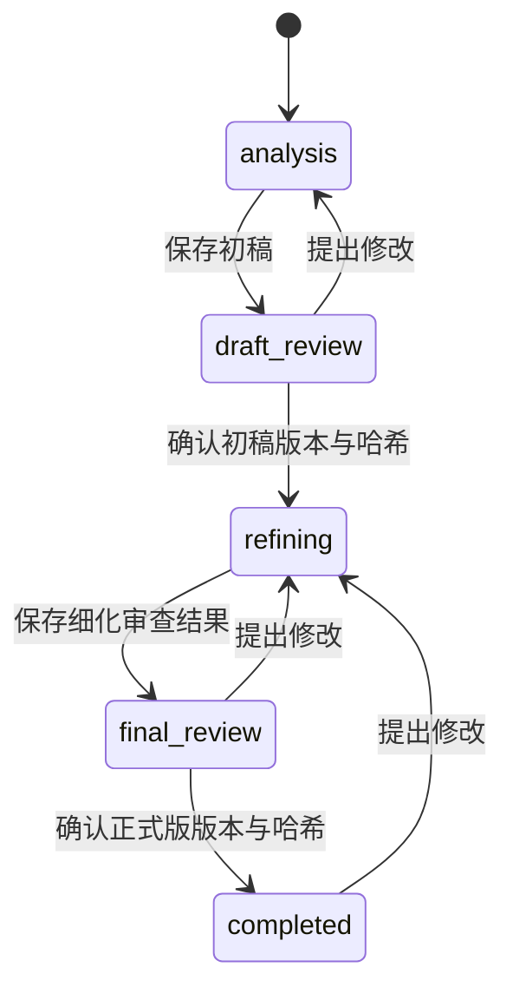

# ABAP FSD 提示词工程完整方案与手工维护指南

## 1. 从哪里开始修改

日常主要编辑 [主提示词.md](主提示词.md)。它相当于 GEMS 的主指令：定义助手是谁、怎么分析业务、什么时候提问、如何区分事实与建议、如何写说明书。多数效果调优先在这里完成。

只有想改变特定工作时，才打开任务或专业规则：报表遗漏基准日，改报表规则；审查忽略一对多重复，改质量审查；助手提问过多，改主提示词第 3 节。

所有发给模型的行为指令都在 Markdown 中。代码负责读取、传入资料、校验、调用工具、保存及阶段守卫；JSON Schema 是机器数据契约，不是另一份自然语言提示词。

## 2. 文件结构与职责

```text
v1/
├─ 主提示词.md                 日常调优的首选入口
├─ 运行协议.md                 每个二级标题是一个调用模板
├─ manifest.json               选择 MD，不存行为指令
├─ 任务/
│  ├─ 讨论.md                  自然语言讨论与业务问题卡
│  ├─ 澄清.md                  ready / clarification
│  ├─ 设计计划.md              业务依赖与完成标准
│  ├─ 起草.md                  完整 FSD JSON 候选
│  ├─ 证据修订.md              按观察与缺陷修订候选
│  └─ 质量审查.md              具体缺陷列表
├─ 类型/                      R、I、C、E 专业设计主题
├─ 实践/                      编辑批处理、逐对象结果
├─ 渲染/                      人工阅读的呈现规则参考
├─ 验收/                      人工评估案例与反例
├─ 目录说明.md                 快速导航，不发给模型
└─ 提示词工程完整方案.md        本文，不发给模型
```

主提示词六节：角色与目标、业务分析、提问策略、事实与证据、阶段工作方式、质量与表达。调整时将规则放回所属章节，不在末尾反复追加日期补丁。

| 任务文件 | 输出                          | 何时调用            |
| -------- | ----------------------------- | ------------------- |
| 讨论     | 中文讨论或澄清卡              | 普通交流            |
| 澄清     | ready 或 clarification        | 生成前检查          |
| 设计计划 | tasks + scenario              | 每次生成候选前      |
| 起草     | 完整 FSD JSON                 | 初稿/正式版候选生成 |
| 证据修订 | 只修改相关内容的完整 FSD JSON | 正式版细化          |
| 质量审查 | findings 数组                 | 正式版修订后        |

“局部修订”指语义上保留无关规则与稳定 ID；当前交换格式返回完整 JSON，不是 JSON Patch。

类型只加载本次对应的一份。目前结构化生成支持 R；I/C/E 有分析规则与契约，但不会因编辑 MD 自动启用生成。实践由设计计划的 `scenario.editable` 和 `scenario.objectFeedback` 决定，规划后重建起草上下文。批量读取本身不等于编辑。

## 3. 模型实际收到什么

一次调用由“主提示词 + 当前任务 + 必要类型/实践 + 协议模板 + 受控数据”组成，不是全目录拼接。

背景包括注册来源、附件提取、系统画像、DEV/QAS、顾问回答、活动规格、当前工作稿、阶段和设计计划。修订保留原规格来源 ID，并为新输入分配不冲突的 ID。附件、历史回复和工具结果只能作为资料，不能覆盖指令。

`运行协议.md` 的二级标题如 `context-background`、`schema`、`repair`、`continuation` 是程序键。**可改正文，不要随意改标题或 {{变量名}}。** 资料中的占位符不会被二次解释执行。

MD 在调用时读取，不依赖 API 重启或手改哈希；每次记录文件、版本及 SHA-256。建议等待当前任务结束再保存调整，避免后续子调用读到刚修改的新规则。运行中的请求不会被追溯修改。

加载仍受目录白名单和路径校验限制；文件缺失、重复模板或缺变量会报错，不静默使用旧规则。纯文档、渲染参考和验收案例不自动加载。

## 4. 可控阶段

业务阶段、模型运行状态、证据程度和顾问确认分开管理。模型调用完成不等于规格已确认。



| 阶段         | 页面名称 | 主要动作                         |
| ------------ | -------- | -------------------------------- |
| analysis     | 需求分析 | 讨论、澄清、生成初稿             |
| draft_review | 初稿审阅 | 确认初稿、提出修改、恢复历史版本 |
| refining     | 细化完善 | 补充讨论、生成正式版、恢复版本   |
| final_review | 终稿审阅 | 确认终稿、提出修改、恢复版本     |
| completed    | 已完成   | 查看、提出修改、恢复版本         |

审阅阶段不能绕过控制直接覆盖生成；先确认或提出修改。确认只改变阶段，不自动调用模型。确认初稿后点击“生成终稿”，空输入框也能基于已确认初稿继续，无需重填需求。

“确认，请继续”等自然语言不签署全文。按钮提交真实动作，服务端记录当前登录人、时间、准确版本与内容哈希。普通修订在当前成熟度内推进；业务范围需重新确认时，恢复相应初稿后修订，不能把旧批准解释为批准了新范围。

## 5. 回退、恢复与并发

选择一个已保存版本，再点击“恢复所选版本”。回退复制出新版本，不覆盖、不删除原版本。恢复初稿进入初稿审阅，恢复正式版进入终稿审阅，确认记录清空。恢复不代表再次批准。

回退创建新上下文基线：旧对话仍可查看，但不会重新灌入新分支覆盖恢复内容；恢复规格保留设计、来源和证据。新回答在新基线上累积。

阶段和活动版本持久化到数据库，刷新可恢复。人工命令有追加式审计事件。不同页面并发确认时，只接受一致的阶段版本；冲突页刷新后需重新审阅。

生成固定阶段与活动版本，保存前再次检查。迟到结果不能覆盖已变化阶段。生成中禁止确认和回退，先停止或等待。

模型流中断不伪装续传。运行使用 90 秒租约与周期心跳，进程退出、租约失效后，在后续状态读取/操作时标记失败，保留记录，可重试。这不等于逐步骤自动断点恢复；重试从已保存规格和真实输入继续。

数据库迁移 SQL 是可执行程序结构，保留它才能运行数据库；迁移历史对照、失效说明和日期补丁不属于提示词工程。

## 6. Plan、ReAct 与质量循环

设计计划最多 8 项，包含目标、依赖、完成标准、关联实体和是否需要证据。依赖只能指向先前任务，不能自循环。计划约束起草与审查，不因模型自述就点亮执行成功。

初稿：可起草性检查 → 设计计划 → 起草 → 结构/来源校验 → 对象核验 → 保存。

正式版：可起草性检查 → 设计计划 → 候选 → 结构校验 → 取证 → 证据修订 → 质量审查 → 必要时再修订/审查 → 保存正式版候选。

ReAct 以受控执行器实现“候选/缺口 → 查询 → 观察 → 修订”。模型不直接执行任意工具，而是提出精确对象候选，执行器调用只读元数据工具；出现新候选时在剩余预算内补查。

每次细化最多查询 12 个不同对象候选，最多 2 次证据/质量修订。同一对象复用本次观察；内容无变化且缺陷未解决时停止并记录 no_progress。元数据摘要截断会显式标记，原始证据另存，不把摘要当完整读取。

审查返回具体缺陷、反例影响及关联实体。critical 未解决阻止正式版发布，保留候选和诊断；major/minor 剩余问题进入 issues，审阅可见。审查通过不代表 SAP 业务测试通过。

结构错误有一次自动修复；输出长度限制最多续写两次。格式修复、续写和业务修订是不同预算，不能无限重试。

## 7. MD 与代码的修改边界

| 目标                         | 修改位置                            |
| ---------------------------- | ----------------------------------- |
| 减少不必要提问、提高推荐质量 | 主提示词第 3 节                     |
| 加强金额、单位、颗粒度分析   | 主提示词第 2 节及类型规则           |
| 改写作风格与信息密度         | 主提示词第 6 节                     |
| 增加可判定业务反例           | 质量审查 + 验收案例                 |
| 改阶段解释                   | 主提示词第 5 节；不能改变程序硬门控 |
| 新增阶段/转移                | workflow、契约、UI 和测试           |
| 新增 JSON 字段/枚举          | Schema、校验、渲染，再同步任务 MD   |
| 启用 I/C/E 生成              | 执行器及完整类型验证                |
| 增加工具、改变预算           | 受控工具适配与执行器                |
| 改页面/导出排版              | UI/渲染代码                         |

错误提示、按钮文字、SQL、状态枚举和工具参数是程序内容，不是隐藏的模型指令。所有指令放 MD，不意味着把数据库守卫交给模型。

## 8. 手工迭代示例

**提问太多：** 改主提示词第 3 节，明确“什么差异会改变业务结果”，增加一个认可的低影响建议例子。不要再加一条“绝不提问”。用已明确日期、未知单位换算、用户暂不确定三种案例回归。

**报表遗漏生命周期：** 改类型/报表功能规则.md，写适用条件、规则和反例。不要把某一项目完整字段清单加进主提示词。回归简单只读报表，确保不引入审批、保存等范围。

**输出太长：** 改主提示词第 6 节，要求规则只定义一次、优先流程与字段表。不要删必需 JSON 字段、异常恢复和测试预期来缩短。

**审查不发现错误：** 改质量审查，增加“两个收货行关联同一订单金额，金额不能算两次”等可判定反例。要求具体规则、影响和修订建议，不要求抽象分数。

每次只调整一个主题，保存修改前 MD 副本。效果变差恢复该文件即可；恢复提示词不会改写已保存的说明书版本。

## 9. 修改后如何验证

在工作台根目录运行：

```powershell
node scripts/check-abap-fsd-rules.mjs
node scripts/check-abap-fsd-prompts.mjs
node --test tests/fs-workspace/unit/assistant-prompt-engineering.test.mjs
node scripts/test-fs.mjs --unit
```

加载/模板检查证明文件能运行，不证明业务效果提高。prose 检查会检查模型消息构造中是否重新加入代码内文本；它是防回归辅助，不能取代代码审查。效果比较要固定输入、模型及配置，覆盖简单报表、复杂单位金额、编辑批处理、历史时点、用户改口、查询失败、回退续作。

记录有效问题数、重复问题数、无依据主张、业务缺陷、用户修订轮次、调用数与耗时。新提示词没有经过这些案例，不宜声称效果优于 GEMS。

完整隔离集成测试：`node scripts/test-fs.mjs`，需要 `.runtime/fs-tests.env` 指向独立本地测试库，不回退使用主数据库。前端检查：`npm run typecheck`、`npm run build`。

## 10. 追溯与程序导航

运行记录规则/协议文件与哈希、来源、附件、阶段快照、步骤和模型响应。子调用在 `snapshot.designCalls`，质量结果在 `snapshot.qualityReview`，结构修复在 `snapshot.repair`。用运行诊断看真实活动，不通过聊天措辞猜测。

| 程序文件          | 职责                            |
| ----------------- | ------------------------------- |
| ruleset.mjs       | 选择 MD、检查路径、计算实际哈希 |
| prompts.mjs       | 加载协议模板并填入数据          |
| context.mjs       | 来源、资料、规则、预算          |
| design-loop.mjs   | 计划、取证反馈、修订与质量循环  |
| executor.mjs      | 步骤、验证、问题合并、保存      |
| workflow.mjs      | 阶段、确认、回退、租约恢复      |
| repository.mjs    | 原子保存不可变版本和活动阶段    |
| session-state.mjs | 活动规格、历史、回退基线        |
| WorkflowPanel.vue | 阶段显示、确认、修订、恢复      |

后端文件在 `apps/api/src/abap-fsd-agent`，前端在 `apps/web/src/features/fs-assistant-test`。效果调优通常不需打开它们。

## 11. 能力边界

本机制用于 FSD 助手及设计阶段，开发 Agent 不进入 FSD 状态机。当前不提供图片 OCR、SAP 写操作、自动业务测试，也不宣称所有 SAP 平台已验证。合成/集成测试不等于真实模型效果或业务验收。

回退恢复规格及上下文基线，不回滚 SAP 或撤销外部业务动作。本助手只查询元数据。
